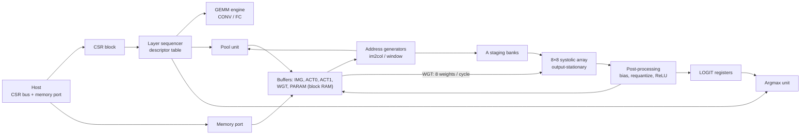
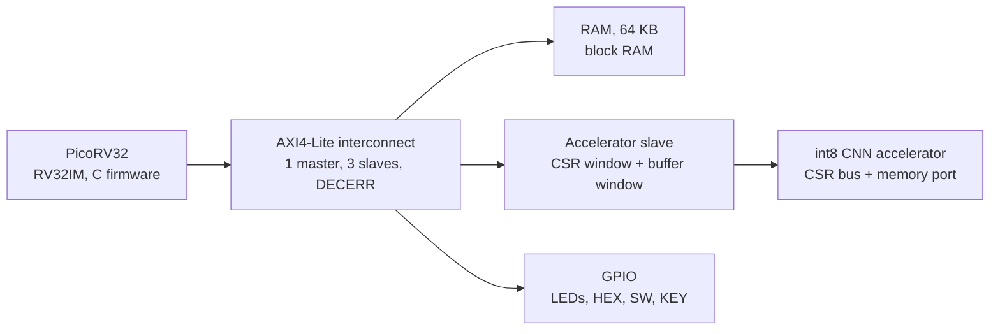

# int8 CNN inference accelerator

A verified int8 CNN accelerator in SystemVerilog: an 8×8 output-stationary systolic array runs
an MNIST network bit-exactly against a Python golden model. As a peripheral of a RISC-V SoC
(PicoRV32, AXI4-Lite, C firmware) it gives a 374.9× speedup over the same integer CNN on
PicoRV32 (49.7× against an ideal one-instruction-per-cycle core at the same clock). Built and timing-closed at 50 MHz for the DE10-Lite (Intel MAX 10); verified in
simulation.

**Stack:** SystemVerilog · UVM (IEEE 1800.2) · cocotb + pytest · Icarus Verilog · Verilator ·
Yosys · SymbiYosys · Python, NumPy, PyTorch · RISC-V (PicoRV32, GCC, C) · AXI4-Lite ·
Quartus Prime Lite · GitHub Actions

<!-- badges:start -->
[](https://github.com/bibeksark7/cnn-accelerator/actions/workflows/ci.yml)
[](https://github.com/bibeksark7/cnn-accelerator/actions/workflows/full.yml)
[](testbench/reports/coverage.md)
[](testbench/reports/mutation.md)
<!-- badges:end -->

## Results

| Metric | Value | Source |
|---|---|---|
| Accuracy, RTL simulation | 98.65 % on the full MNIST test set (9,865 / 10,000); all 100,000 logits bit-exact vs the golden model | [full run](testbench/reports/full_run.md) |
| Float vs integer model accuracy | 98.67 % vs 98.65 % | [quantization report](model/reports/quantize.json) |
| Cycles per inference | 47,259; 0.945 ms and 1,058 inferences/s at 50 MHz (compute only; images preloaded); identical for every image | [counters](testbench/reports/perf_counters.md) |
| MAC array busy | 3,869 cycles per inference (8.2 %) | [counters](testbench/reports/perf_counters.md) |
| Timing on MAX 10 (10M50DAF484C7G) | 65.85 MHz Fmax; worst slack at 50 MHz over all three corners: +4.813 ns setup, +0.095 ns hold | [Fmax](fpga/de10lite/reports/fmax.rpt), [timing per corner](fpga/de10lite/reports/timing_corners.rpt), [summary](fpga/de10lite/reports/de10lite.sta.summary) |
| Resources (whole demo) | 8,322 LEs (17 %), 5,587 registers, 340,608 memory bits (20 %), 68 9-bit multipliers | [fit summary](fpga/de10lite/reports/de10lite.fit.summary) |
| SoC speedup | 374.9× end to end over the same integer CNN on PicoRV32 (217.8× counting the image upload); against an ideal one-instruction-per-cycle core at the same clock, 49.7× (28.9× with the upload) | [speedup report](testbench/reports/soc_speedup.md), [SoC](#risc-v-soc) |
| Mutation testing | 55 / 55 injected bugs caught (accelerator and SoC) | [mutation report](testbench/reports/mutation.md) |
| Functional coverage | every goal met or documented as a gap (bins sampled from the design) | [coverage report](testbench/reports/coverage.md) |
| UVM testbench (AXI4-Lite slave) | 7 tests + 3 protocol-violation tests; 207 / 207 coverage bins with one fixed seed per test, and 207 / 207 bins over 70 runs with 10 random seeds per test; 18 / 18 injected bugs caught, each through its named mechanism | [UVM coverage](testbench/reports/uvm_coverage.md), [seed sweep](testbench/reports/uvm_seed_sweep.md), [scoreboard checks](testbench/reports/uvm_checks.md), [UVM mutation report](testbench/reports/uvm_mutation.md) |

The array is busy only 8.2 % of the cycles because its im2col operands are staged one byte per
cycle before each tile streams, so staging takes about eight times as long as streaming; Milestone
1 is correctness first ([why, and the fix](docs/architecture.md#feeding-the-array-the-bandwidth-problem-spec-5)).

## Three bugs worth telling

- **A bug hidden by arithmetic** (BUG-011): an ARGMAX descriptor naming the image buffer added
  the image offset (`IMG_SEL × 784`) to its logit index; it vanished only because 784 is a
  multiple of 16. Found in code review; fixed in the spec (ARGMAX must read LOGIT) and the RTL.
- **A test suite that could not see saturation** (BUG-014): with saturation removed from the
  requantizer, every system test still passed, because no quick-subset image saturates. A
  deliberate CI failure run exposed it; the 4 test images that do saturate now run in CI.
- **Assertions that fired after a one-cycle reset** (BUG-010): `$past`-based properties looked
  back into the reset cycle; the fix excludes the cycle after reset.

Every bug: symptom, how it was found, root cause, fix and regression test in
[docs/bug_log.md](docs/bug_log.md).

## Architecture



- One GEMM engine runs both convolutions (via im2col) and the FC layer; the network is a table of
  layer descriptors, so the hardware has no network-specific control.
- int8 activations and weights, int32 accumulation, per-channel requantization
  (`(y·M + 2^(S−1)) >>> S`, saturate, ReLU) in a 4-stage valid/ready pipeline.
- One owner per buffer port at any time, enforced by registered one-hot owner vectors and checked
  by assertions.
- DE10-Lite top (simulated at its pins): 16 preloaded test images, SW[3:0] selects one, KEY[0]
  runs it, HEX0 shows the prediction, HEX1 the true label, HEX5..HEX2 the cycle count.

How and why: [docs/architecture.md](docs/architecture.md). Normative spec:
[docs/spec.md](docs/spec.md). Decisions and alternatives: [docs/decisions.md](docs/decisions.md).

## RISC-V SoC

The accelerator, unchanged, also runs as a peripheral of a small RISC-V system: C firmware on a
PicoRV32 core uploads each image over AXI4-Lite, starts the accelerator, polls it and reads back
the logits. Built and timing-closed for the DE10-Lite; verified in simulation (the whole SoC,
firmware included, on Verilator).



<!-- fpga-numbers: de10lite_soc -->
| Metric | Value | Source |
|---|---|---|
| Speedup | 374.9× end to end over the same integer CNN on PicoRV32; 217.8× counting the 784-byte image upload (mean of 4 images) |
| Speedup against an ideal core | 49.7× end to end, 28.9× with the upload: the software CNN's 2,383,369 instructions divided by the accelerator's cycles, i.e. against a core at the same clock that retires one instruction per cycle | [speedup report](testbench/reports/soc_speedup.md) |
| Cycles per image | software CNN 17,987,202 (359.74 ms at 50 MHz); accelerator end to end 47,984 (0.960 ms), of which the accelerator core 47,259; image upload 34,591 | [speedup report](testbench/reports/soc_speedup.md) |
| Correctness | firmware runs the 50 quick-subset images through the accelerator in CI: RESULT and every logit equal the golden model's; the software CNN's logits equal it too | [`test_soc.py`](testbench/system/test_soc.py) |
| Timing on MAX 10 (10M50DAF484C7G) | 69.04 MHz Fmax; worst slack at 50 MHz over all three corners: +5.515 ns setup, +0.090 ns hold | [Fmax](fpga/de10lite_soc/reports/fmax.rpt), [timing per corner](fpga/de10lite_soc/reports/timing_corners.rpt), [summary](fpga/de10lite_soc/reports/de10lite_soc.sta.summary) |
| Resources (whole SoC) | 12,475 LEs (25 %), 7,297 registers, 867,520 memory bits (52 %), 76 9-bit multipliers | [fit summary](fpga/de10lite_soc/reports/de10lite_soc.fit.summary) |
<!-- fpga-numbers: end -->

The speedup compares this SoC with and without its accelerator. PicoRV32 is a multi-cycle core
without caches, and every instruction fetch is an AXI4-Lite access to the RAM (7.55 cycles per
instruction on the software CNN), so a faster CPU would narrow the gap. The instruction-count
bound shows by how much: even a core that ran the same instructions at one per cycle would be
49.7× slower than the accelerator, end to end.

- Own AXI4-Lite blocks: one slave front end shared by every slave, an interconnect that answers
  unmapped addresses with DECERR, a RAM whose byte and halfword stores are read-modify-writes so
  it maps to block RAM (BUG-015), and GPIO registers.
- The accelerator's CSR bus and memory port are unchanged; a thin slave maps them to a CSR window
  and a buffer window (64-bit buffer words as two 32-bit halves). CSR reads are never held during
  a run, so firmware can poll STATUS while the accelerator works.
- Every SoC test fails on any SLVERR or DECERR response and on a CPU trap (PicoRV32 ignores bus
  responses, so an error would otherwise pass silently).
- Firmware: `crt0.S`, linker script, driver API, the inference app, the software CNN (checked
  against the golden model) and a board demo that shows the prediction and the measured speedup
  on the HEX displays.

Spec: [docs/spec.md §13](docs/spec.md).

## Verification

- **Golden model** in NumPy (`model/golden.py`), every primitive checked against a naive
  reference; the RTL matches it bit for bit.
- **Unit tests** for every block (cocotb + pytest, Icarus Verilog and Verilator), directed and
  constrained-random with fixed seeds; **system tests** of the whole accelerator, the FPGA core
  (bring-up: register read-back, 16 demo runs) and the board top (pins only).
- **SystemVerilog assertions** on the handshakes, buffer ownership, scheduling and FSM states
  (Verilator); the interface and legal-state ones are shown to fire on deliberate violations.
- **Formal proofs** (SymbiYosys): the MAC cell, argmax (unbounded at reduced width, bounded at
  full width) and the post-processing pipeline's handshake, including progress properties.
- **Functional coverage** sampled from DUT signals, with goals and written reasons for gaps.
- **Mutation testing**: 55 single-bug patches, each caught by its named test: in the accelerator
  (rounding, saturation, ReLU, skew, ping-pong, handshakes, control path,
  counters) and in the SoC (AXI4-Lite
  handshakes and buffering, interconnect routing and DECERR, byte-write merging, register rules,
  the address map).
- **SoC tests**: unit tests for each AXI4-Lite block, the accelerator behind its AXI4-Lite slave
  with every accelerator assertion bound, and firmware-driven runs of the whole SoC with AXI4-Lite
  channel assertions on every slave.
- **UVM testbench** (`testbench/uvm/`, Verilator + the IEEE 1800.2 reference library): an AXI4-Lite
  agent with independent channel timing and two transactions in flight per direction, a register
  model of the CSR map with a backdoor for IMG_SEL and the descriptor table, the design's own
  AXI4-Lite channel checker bound to the interface, and a scoreboard that checks every response
  and every read whose value is determined, including which writes a running accelerator must
  ignore and which accesses it must hold, without assuming any latency (checked and unpredictable
  reads per test: [scoreboard checks](testbench/reports/uvm_checks.md)). Seven tests: register
  reset values, bit-bash and frontdoor-against-backdoor access, random bus and error traffic, all
  54 reference images uploaded and run through the bus bit-exact, polling during runs, every
  descriptor error (directed and constrained-random), reset mid-run, and a fully concurrent mix.
  Each test runs with one fixed seed on every push and with 10 random seeds nightly.
- **Full run**: all 10,000 MNIST test images, with the commit and RTL tree recorded in the report.
- **CI** (GitHub Actions): a fast job on every push (lint, every unit test, the quick-subset system
  tests, the UVM bench) and the full regression, formal proofs and slow tests included, nightly and
  on demand.

Plan and status per feature: [docs/verification_plan.md](docs/verification_plan.md).

## How to run

```sh
python3.14 -m venv .venv && source .venv/bin/activate
pip install -r requirements.txt          # simulation and tests (CI uses only this)
source scripts/env.sh                    # tools on PATH: Icarus 12, Verilator >= 5.036, OSS CAD Suite

pytest testbench model/tests scripts/tests   # every test (unit, system, formal, model, scripts)
scripts/lint.sh                          # Verilator -Wall, Icarus, Yosys, Quartus-compatibility checks
scripts/run_mutants.py                   # mutation testing
scripts/coverage_report.py --run         # functional coverage report
scripts/full_run.py                      # 10,000-image run (needs the MNIST cache in data/)
fpga/de10lite/build_win.sh               # Quartus build (Windows Quartus Prime Lite from WSL)

git submodule update --init              # PicoRV32 (the SoC) and uvm-core (the UVM bench)
pytest testbench/uvm                     # UVM bench (Verilator; builds in about 2.5 minutes)
make -C firmware APP=quick               # firmware (riscv64-unknown-elf-gcc, RV32IM)
pytest testbench/system/test_soc.py      # the SoC running firmware (Verilator)
scripts/soc_speedup.py --images 4        # speedup report (minutes of simulation per image)
fpga/de10lite_soc/build_win.sh           # Quartus build of the SoC
```

Training and quantization (`pip install -r requirements-dev.txt`): `python -m model.train`,
`python -m model.quantize`, `python -m model.export`.

## Data

The network is trained and evaluated on the [MNIST database](http://yann.lecun.com/exdb/mnist/)
of handwritten digits by Yann LeCun, Corinna Cortes and Christopher J. C. Burges, used under the
[Creative Commons Attribution-Share Alike 3.0](https://creativecommons.org/licenses/by-sa/3.0/)
license (CC BY-SA 3.0). The repository commits a few MNIST test images and their labels:
`model/artifacts/quick_subset.npz` (50 images, the CI system test),
`model/artifacts/saturation_subset.npz` (the 4 images that saturate) and
`model/artifacts/mem/img.hex` and `label.hex` (the 16 board-demo images). These files are
distributed under CC BY-SA 3.0, not the MIT license. The full dataset is downloaded at training
time into the git-ignored `data/` directory and is never committed.

## Repository

| Path | Contents |
|---|---|
| `rtl/` | `core/` array and GEMM engine, `addr/` address generators, `post/` post-processing, pool, argmax, `mem/` buffers and ports, `ctrl/` CSR, sequencer, counters, `top/` accelerator and FPGA tops, `axi/` AXI4-Lite blocks, `soc/` SoC and its board top |
| `firmware/` | `common/` startup, linker script, accelerator driver, software CNN; `apps/` smoke, quick subset, bench, board demo |
| `third_party/` | PicoRV32 and uvm-core (git submodules) |
| `testbench/` | `unit/`, `system/` (cocotb), `uvm/` (UVM bench), `sva/` assertions, `formal/` proofs, `mutants/` bug patches, `reports/` |
| `model/` | training, quantization, golden model, export; `artifacts/` committed weights and test vectors; `reports/` |
| `fpga/de10lite/`, `fpga/de10lite_soc/` | build scripts, pins, constraints, build reports (accelerator demo, SoC) |
| `scripts/` | lint, checkpoints, mutation runner, coverage and full-run reports |
| `docs/` | spec, architecture, verification plan, decisions, bug log |

## License

MIT ([LICENSE](LICENSE)), except the MNIST-derived files listed under [Data](#data)
(CC BY-SA 3.0).
