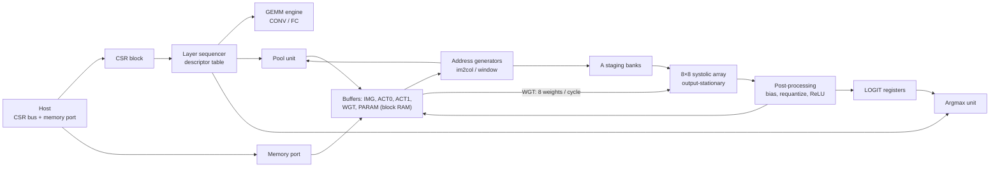

# int8 CNN inference accelerator

A verified int8 CNN accelerator in SystemVerilog: an 8×8 output-stationary systolic array runs
an MNIST network bit-exactly against a Python golden model. Built and timing-closed at 50 MHz
for the DE10-Lite (Intel MAX 10); verified in simulation.

**Stack:** SystemVerilog · cocotb + pytest · Icarus Verilog · Verilator · Yosys · SymbiYosys ·
Python, NumPy, PyTorch · Quartus Prime Lite · GitHub Actions

<!-- badges:start -->
[](https://github.com/bibeksark7/cnn-accelerator/actions/workflows/ci.yml)
[](testbench/reports/coverage.md)
[](testbench/reports/mutation.md)
<!-- badges:end -->

## Results

| Metric | Value | Source |
|---|---|---|
| Accuracy, RTL simulation | 98.65 % on the full MNIST test set (9,865 / 10,000); all 100,000 logits bit-exact vs the golden model | [full run](testbench/reports/full_run.md) |
| Float vs integer model accuracy | 98.67 % vs 98.65 % | [quantization report](model/reports/quantize.json) |
| Cycles per inference | 47,259; 0.945 ms and 1,058 inferences/s at 50 MHz (compute only; images preloaded); identical for every image | [counters](testbench/reports/perf_counters.md) |
| MAC array busy | 3,869 cycles per inference (8.2 %) | [counters](testbench/reports/perf_counters.md) |
| Timing on MAX 10 (10M50DAF484C7G) | 65.85 MHz Fmax; worst slack at 50 MHz over all three corners: +4.813 ns setup, +0.095 ns hold | [Fmax](fpga/de10lite/reports/fmax.rpt), [timing per corner](fpga/de10lite/reports/timing_corners.rpt), [summary](fpga/de10lite/reports/de10lite.sta.summary) |
| Resources (whole demo) | 8,322 LEs (17 %), 5,587 registers, 340,608 memory bits (20 %), 68 9-bit multipliers | [fit summary](fpga/de10lite/reports/de10lite.fit.summary) |
| Mutation testing | 34 / 34 injected bugs caught | [mutation report](testbench/reports/mutation.md) |
| Functional coverage | every goal met or documented as a gap (bins sampled from the design) | [coverage report](testbench/reports/coverage.md) |

The array is busy only 8.2 % of the cycles because its im2col operands are staged one byte per
cycle before each tile streams, so staging takes about eight times as long as streaming; Milestone
1 is correctness first ([why, and the fix](docs/architecture.md#feeding-the-array-the-bandwidth-problem-spec-5)).

## Three bugs worth telling

- **A bug hidden by arithmetic** (BUG-011): an ARGMAX descriptor naming the image buffer added
  the image offset (`IMG_SEL × 784`) to its logit index; it vanished only because 784 is a
  multiple of 16. Found in code review; fixed in the spec (ARGMAX must read LOGIT) and the RTL.
- **A test suite that could not see saturation** (BUG-014): with saturation removed from the
  requantizer, every system test still passed, because no quick-subset image saturates. A
  deliberate CI failure run exposed it; the 4 test images that do saturate now run in CI.
- **Assertions that fired after a one-cycle reset** (BUG-010): `$past`-based properties looked
  back into the reset cycle; the fix excludes the cycle after reset.

Every bug: symptom, how it was found, root cause, fix and regression test in
[docs/bug_log.md](docs/bug_log.md).

## Architecture



- One GEMM engine runs both convolutions (via im2col) and the FC layer; the network is a table of
  layer descriptors, so the hardware has no network-specific control.
- int8 activations and weights, int32 accumulation, per-channel requantization
  (`(y·M + 2^(S−1)) >>> S`, saturate, ReLU) in a 4-stage valid/ready pipeline.
- One owner per buffer port at any time, enforced by registered one-hot owner vectors and checked
  by assertions.
- DE10-Lite top (simulated at its pins): 16 preloaded test images, SW[3:0] selects one, KEY[0]
  runs it, HEX0 shows the prediction, HEX1 the true label, HEX5..HEX2 the cycle count.

How and why: [docs/architecture.md](docs/architecture.md). Normative spec:
[docs/spec.md](docs/spec.md). Decisions and alternatives: [docs/decisions.md](docs/decisions.md).

## Verification

- **Golden model** in NumPy (`model/golden.py`), every primitive checked against a naive
  reference; the RTL matches it bit for bit.
- **Unit tests** for every block (cocotb + pytest, Icarus Verilog and Verilator), directed and
  constrained-random with fixed seeds; **system tests** of the whole accelerator, the FPGA core
  (bring-up: register read-back, 16 demo runs) and the board top (pins only).
- **SystemVerilog assertions** on the handshakes, buffer ownership, scheduling and FSM states
  (Verilator); the interface and legal-state ones are shown to fire on deliberate violations.
- **Formal proofs** (SymbiYosys): the MAC cell, argmax (unbounded at reduced width, bounded at
  full width) and the post-processing pipeline's handshake, including progress properties.
- **Functional coverage** sampled from DUT signals, with goals and written reasons for gaps.
- **Mutation testing**: 34 single-bug patches (rounding, saturation, ReLU, skew, ping-pong,
  handshakes, control path), each caught by its named test.
- **Full run**: all 10,000 MNIST test images, with the commit and RTL tree recorded in the report.

Plan and status per feature: [docs/verification_plan.md](docs/verification_plan.md).

## How to run

```sh
python3.14 -m venv .venv && source .venv/bin/activate
pip install -r requirements.txt          # simulation and tests (CI uses only this)
source scripts/env.sh                    # tools on PATH: Icarus 12, Verilator >= 5.036, OSS CAD Suite

pytest testbench model/tests scripts/tests   # every test (unit, system, formal, model, scripts)
scripts/lint.sh                          # Verilator -Wall, Icarus, Yosys, Quartus-compatibility checks
scripts/run_mutants.py                   # mutation testing
scripts/coverage_report.py --run         # functional coverage report
scripts/full_run.py                      # 10,000-image run (needs the MNIST cache in data/)
fpga/de10lite/build_win.sh               # Quartus build (Windows Quartus Prime Lite from WSL)
```

Training and quantization (`pip install -r requirements-dev.txt`): `python -m model.train`,
`python -m model.quantize`, `python -m model.export`.

## Data

The network is trained and evaluated on the [MNIST database](http://yann.lecun.com/exdb/mnist/)
of handwritten digits by Yann LeCun, Corinna Cortes and Christopher J. C. Burges, used under the
[Creative Commons Attribution-Share Alike 3.0](https://creativecommons.org/licenses/by-sa/3.0/)
license (CC BY-SA 3.0). The repository commits a few MNIST test images and their labels:
`model/artifacts/quick_subset.npz` (50 images, the CI system test),
`model/artifacts/saturation_subset.npz` (the 4 images that saturate) and
`model/artifacts/mem/img.hex` and `label.hex` (the 16 board-demo images). These files are
distributed under CC BY-SA 3.0, not the MIT license. The full dataset is downloaded at training
time into the git-ignored `data/` directory and is never committed.

## Repository

| Path | Contents |
|---|---|
| `rtl/` | `core/` array and GEMM engine, `addr/` address generators, `post/` post-processing, pool, argmax, `mem/` buffers and ports, `ctrl/` CSR, sequencer, counters, `top/` accelerator and FPGA tops |
| `testbench/` | `unit/`, `system/` (cocotb), `sva/` assertions, `formal/` proofs, `mutants/` bug patches, `reports/` |
| `model/` | training, quantization, golden model, export; `artifacts/` committed weights and test vectors; `reports/` |
| `fpga/de10lite/` | build scripts, pins, constraints, build reports |
| `scripts/` | lint, checkpoints, mutation runner, coverage and full-run reports |
| `docs/` | spec, architecture, verification plan, decisions, bug log |

## License

MIT ([LICENSE](LICENSE)), except the MNIST-derived files listed under [Data](#data)
(CC BY-SA 3.0).
