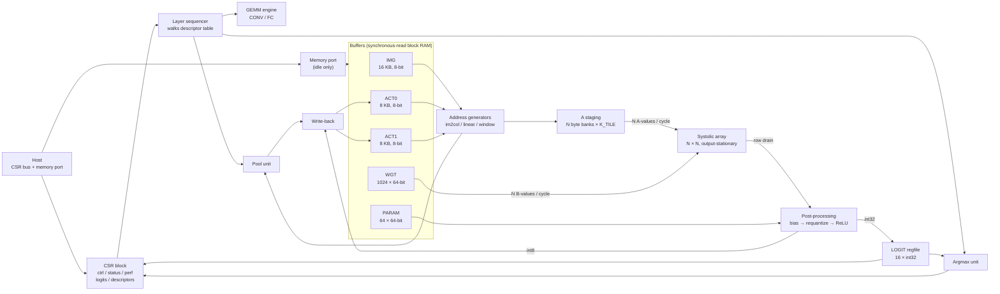
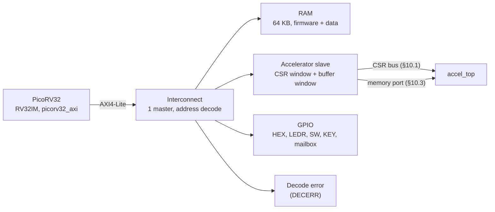

# Accelerator specification

Authoritative hardware specification for the int8 MNIST CNN accelerator (Milestone 1) and the
RISC-V SoC around it (Milestone 2, §13).
Changes to this document, or to any interface it defines, are recorded in `docs/decisions.md`.

**Normative scope.** Binding requirements are:
- the arithmetic (§3);
- the data layouts and memory formats (§4–§7);
- the descriptor format and execution semantics (§8–§9);
- the host interface (§10);
- the `accel_top` and `systolic_array` interfaces (§11);
- the SoC: its CPU configuration, address map, bus behaviour, peripheral registers and board
  top (§13.1–§13.7), and the speedup definitions (§13.9).

Internal module partitioning and internal interfaces are implementation choices. They are
documented in each module's header and summarized in `docs/architecture.md`.

**Reference model.** `model/golden.py` (arithmetic) and `model/hwmap.py` (memory and descriptor
formats) implement this specification in software. The RTL must match them bit for bit.

---

## 1. Network and build-time parameters

| Layer | Op | Input (H×W×C) | Output | GEMM M × K × Ncols |
|---|---|---|---|---|
| conv1 | 3×3 conv, stride 1, no padding, bias, requantize, ReLU | 28×28×1 | 26×26×8 | 676 × 9 × 8 |
| pool1 | 2×2 max, stride 2 | 26×26×8 | 13×13×8 | — |
| conv2 | 3×3 conv, stride 1, no padding, bias, requantize, ReLU | 13×13×8 | 11×11×16 | 121 × 72 × 16 |
| pool2 | 2×2 max, stride 2, floor | 11×11×16 | 5×5×16 | — |
| fc | fully connected, bias, no requantization | 5×5×16 (400) | 10 × int32 | 1 × 400 × 10 |
| argmax | lowest index of the maximum logit | 10 × int32 | class 0–9 | — |

| Parameter | Default | Meaning |
|---|---|---|
| `N` | 8 | systolic array is N × N |
| `DATA_W` | 8 | activation and weight width (signed) |
| `ACC_W` | 32 | accumulator width (signed) |
| `K_TILE` | 128 | A-staging depth; GEMMs with K > `K_TILE` run in K chunks (fc: 4 chunks) |
| `IMG_DEPTH` | 16384 | image buffer, bytes |
| `IMG_SIZE` | 784 | bytes per input image |
| `ACT_DEPTH` | 8192 | each activation buffer, bytes |
| `WGT_DEPTH` | 1024 | weight buffer, `N·DATA_W`-bit words |
| `PARAM_DEPTH` | 64 | parameter buffer, 64-bit words |
| `LOGIT_DEPTH` | 16 | logit register file, int32 entries |
| `DESC_DEPTH` | 8 | descriptor table, layers |
| `PERF_W` | 32 | performance counter width (§10.2) |

One clock domain (`clk`), synchronous active-high reset (`rst`). Target: 50 MHz on the MAX 10.

## 2. Block diagram



## 3. Arithmetic (bit-exact)

All values are two's complement. `>>>` is an arithmetic right shift.

| Step | Definition | Width |
|---|---|---|
| Input bytes | `q = pixel >> 1` (done offline; buffers hold `q`, 0–127) | int8 |
| Accumulate | `acc[m][n] = Σ_k A[m][k] · B[k][n]` | int32 |
| Bias | `y = acc + bias[n]` | int32 |
| Product | `p = y · M[n]`, `M` unsigned in [2^15, 2^16 − 1] | 48-bit signed |
| Round | `r = (p + 2^(S[n]−1)) >>> S[n]`, `S` in [1, 47] (round half up) | ≥ 49-bit signed |
| Saturate | `q8 = clamp(r, −128, 127)` | int8 |
| ReLU | if `relu_en`: `q8 = max(q8, 0)` | int8 |
| FC output | `logit[n] = y` (no requantization) | int32 |
| Pool | `max` over a 2×2 window (signed compare) | int8 |
| Argmax | lowest index `i` with `logit[i]` = max (signed compare) | index |

- **Accumulator overflow.** The accumulator and the bias add wrap modulo 2^32 in hardware. The golden
  model proves wrap never happens: for every GEMM it asserts
  `Σ_k |A·B| + |bias| ≤ 2^31 − 1`, which bounds every partial sum in any accumulation order.
  Saturation is therefore not implemented.
- **Requantization** applies only when `requant_en = 1` (CONV). `relu_en` applies only when
  `requant_en = 1`.
- **Weights** are int8 in [−127, 127] (symmetric). Activations after ReLU are in [0, 127]. The
  arithmetic is still defined for any int8 inputs (including −128), and unit tests use the full range.

### 3.1 Post-processing implementation

- **Signed multiply.** `M` is unsigned, but the accumulator path is signed, so the multiplier
  operand is zero-extended to 17 bits and treated as signed: `p = $signed(y) * $signed({1'b0, M})`.
  Multiplying a signed `y` by an unsigned `M` directly would make Verilog treat the whole
  expression as unsigned and corrupt negative products. The 32 × 17 signed product is 49 bits wide
  and its value always fits in 48 bits (`|y| < 2^31`, `M < 2^16`).
- **Rounding and shift.** The rounding constant is a signed value at least 49 bits wide, for
  example `49'sd1 <<< (S − 1)`, added to the sign-extended product. The arithmetic shift `>>>` must
  be applied to a signed operand: in Verilog, `>>>` on an unsigned operand is a logical shift and
  would turn negative results positive.
- **Pipelining.** For timing margin at 50 MHz, post-processing is pipelined in at least three
  register stages, in this order:
  1. bias add and multiply (`y`, then `p`). This may take two stages: register `y`, `M` and `S`,
     then multiply the registered operands into a registered product so the multiplier maps
     onto DSP blocks;
  2. rounding add and arithmetic shift (`r`);
  3. saturate and ReLU (`q8`).

  The pipeline uses valid/ready handshakes; its latency is not part of any interface.

Scales and how `M`, `S` and biases are derived are in `model/quantize.py`; the hardware only sees
the integers.

## 4. Data layouts

- **Activations are HWC (channel-last).** Element `(y, x, c)` of an `H × W × C` tensor is at byte
  offset `(y · W + x) · C + c` from the tensor's base.
- **Input images** are 28×28×1 row-major: image `i` occupies IMG bytes `[i · 784, i · 784 + 783]`.
- **im2col (CONV).** For output pixel `m = oy · W_out + ox` and reduction index
  `k = (ky · 3 + kx) · C_in + ci`:
  `A[m][k] = src[src_base + ((oy + ky) · W_in + (ox + kx)) · C_in + ci]`, and
  `B[k][co] = w[co][ky][kx][ci]`. `K = 9 · C_in`, `M = H_out · W_out`, `Ncols = C_out`.
  The output element `(m, co)` is written to `dst[m · C_out + co]`, which is HWC.
- **FC.** `A[0][k] = src[k]` for `k < K = H_in · W_in · C_in` (the HWC tensor read linearly),
  `M = 1`, `B[k][n] = w_fc[n][k]` with `k` in HWC order. Output `n` goes to `LOGIT[dst_base + n]`.

## 5. Buffers and buffer bandwidth

| Buffer | Width | Depth | Contents | Engine access |
|---|---|---|---|---|
| IMG | 8 | `IMG_DEPTH` | up to 16 input images (`q` bytes) | read (CONV/POOL/FC source) |
| ACT0, ACT1 | 8 | `ACT_DEPTH` | ping-pong activations | read or write |
| WGT | `N·DATA_W` | `WGT_DEPTH` | packed GEMM B matrices (§6) | read |
| PARAM | 64 | `PARAM_DEPTH` | per-output-channel bias, M, S (§7) | read |
| LOGIT | 32 | `LOGIT_DEPTH` | FC outputs (registers) | write (FC), read (ARGMAX, CSR) |

- Every buffer is an inferred synchronous-read RAM with **one read port and one write port**.
  **Read latency is exactly 1 cycle**; this latency is part of the buffer interface.
- A layer never reads and writes the same buffer (§9), so each buffer needs only one port of
  each kind.
- Buffers can be preloaded from `$readmemh` files (FPGA) and are always reachable through the
  memory port (§10.3) while the accelerator is idle.
- **Addresses.** Every depth is a power of two, and addresses are taken modulo the depth: bits
  above a buffer's address width are ignored. With the default depths the widths are IMG 14 bits
  (16 images × 784 bytes = 12,544 bytes need 14), ACT0 and ACT1 13, WGT 10, PARAM 6, LOGIT 4 and
  the descriptor table 5 (word addresses). No access is ever out of range; a descriptor whose
  addresses exceed a buffer wraps around inside it (not detected, §9).
- **Ownership.** IMG, ACT0, ACT1, WGT and PARAM each have at most one owner at a time, given by
  a registered one-hot owner vector per buffer:
  - while idle, the memory port owns every buffer;
  - during a run, the unit executing the current layer owns the buffers its descriptor names
    (CONV and FC: `src`, WGT and PARAM, plus CONV's `dst`; POOL: `src` and `dst`; ARGMAX: none);
  - between layers, nothing is owned.

  Requests from a non-owner never reach a buffer. The owner vectors change only while every unit
  is idle (checked by an assertion in simulation).
- **Read-data return.** Read data goes to every requester. The data returned to the units is
  selected by the layer's `src` field, which is registered before the layer starts and stays
  constant while it runs. The memory port registers its buffer select with each read.

**Bandwidth scheme.** The array consumes N A-values and N B-values per cycle.
- **B (weights)** are pre-packed offline so that one `N·DATA_W`-bit WGT word holds the N
  B-values of one reduction step (§6): **one WGT read per cycle feeds the array**.
- **A (activations)** come from an im2col gather that is not contiguous in memory, so A is
  **staged** before it is streamed:
  1. **Stage.** The A loader walks the tile's `N` rows and the current K chunk (`≤ K_TILE`)
     through the address generator. It reads **one byte per cycle** and writes it into staging
     bank `i` (tile row `i`) at address `k − k0`. Rows `m ≥ M` (padded rows of an edge tile)
     are not staged, and steps `k ≥ K` never occur (a chunk is at most `K − k0` steps long).
  2. **Stream.** For each `k` in the chunk, all N staging banks are read in parallel (N A-values)
     together with one WGT word (N B-values) and presented to the array as one step.
     **Padded rows are forced to zero at the array input**: the A-values of rows `m ≥ M`
     are presented as 0, whatever their staging bank holds.

  **Optional reuse.** When `K ≤ K_TILE` (a single chunk), the engine may keep the staged A tile and
  reuse it for every column tile `nt` of the same row tile instead of restaging it. Buffer
  contents after the layer are identical either way.

  Staging costs `N · Kc` cycles per chunk against `Kc` cycles of streaming. That limits MAC
  utilization, which is acceptable for Milestone 1 (correctness first, no cycle target).
  Double-buffered staging or N-banked activation buffers are possible later optimizations.

The current network uses 953 WGT words and 34 PARAM words
(`model/artifacts/mem/layout.json`, generated by `model/export.py`).

## 6. Weight buffer format

For a GEMM with reduction length `K` and `Ncols` output columns, column tile `nt`
(`0 ≤ nt < ⌈Ncols / N⌉`) and reduction step `k` map to word `wgt_base + nt · K + k`:

```
bits [8j+7 : 8j] = B[k][nt·N + j]   for j = 0 .. N−1   (0 when nt·N + j ≥ Ncols)
```

Reference implementation: `model/hwmap.py::pack_b`.

## 7. Parameter buffer format

One 64-bit word per output channel, at `param_base + n`:

| Bits | Field |
|---|---|
| [31:0] | `bias` (int32) |
| [47:32] | `M` (unsigned 16-bit; 0 for FC) |
| [53:48] | `S` (unsigned 6-bit; 0 for FC) |
| [63:54] | reserved, 0 |

Reference implementation: `model/hwmap.py::pack_params`.

## 8. Layer descriptor format

The descriptor table holds `DESC_DEPTH` descriptors of four 32-bit words; descriptor `L` occupies
words `4L .. 4L+3`. The table is written through the CSR window (§10.2) or preloaded from a
`$readmemh` file. Reference implementation: `model/hwmap.py::Descriptor`.

| Word | Bits | Field | Meaning |
|---|---|---|---|
| 0 | [2:0] | `op` | 0 CONV, 1 POOL, 2 FC, 3 ARGMAX, 4–7 reserved |
| 0 | [3] | `relu_en` | ReLU after requantization (CONV) |
| 0 | [4] | `requant_en` | requantize to int8 (CONV); 0 for FC |
| 0 | [5] | `last` | last layer: the run ends after this descriptor |
| 0 | [9:8] | `src` | source buffer: 0 IMG, 1 ACT0, 2 ACT1, 3 LOGIT (LOGIT only for ARGMAX, which must use it; §9) |
| 0 | [13:12] | `dst` | destination buffer (same encoding; LOGIT for FC, ACT0/ACT1 for CONV and POOL; ignored by ARGMAX; §9) |
| 1 | [15:0] | `src_base` | source base address (bytes; LOGIT entries for ARGMAX) |
| 1 | [31:16] | `dst_base` | destination base address (bytes; LOGIT entries for FC) |
| 2 | [7:0] | `h_in` | input height |
| 2 | [15:8] | `w_in` | input width |
| 2 | [23:16] | `c_in` | input channels (ARGMAX: number of logits) |
| 2 | [31:24] | `c_out` | output channels (POOL: equal to `c_in`) |
| 3 | [15:0] | `wgt_base` | WGT word address of the layer's packed B (CONV/FC) |
| 3 | [23:16] | `param_base` | PARAM word address of the layer's channel 0 (CONV/FC) |

All other bits are reserved and must be 0.

**Registered fields.** Before starting a layer, the sequencer reads the descriptor's four words
into registers, and the units are configured from those registers. The configuration is therefore
constant while a layer runs, and the table itself (writable only while idle) is read once per
layer.

The network's table is
`model/artifacts/mem/desc.hex`:

| L | op | src → dst | h_in × w_in × c_in → c_out | flags |
|---|---|---|---|---|
| 0 | CONV | IMG → ACT0 | 28×28×1 → 8 | relu, requant |
| 1 | POOL | ACT0 → ACT1 | 26×26×8 → 8 | |
| 2 | CONV | ACT1 → ACT0 | 13×13×8 → 16 | relu, requant |
| 3 | POOL | ACT0 → ACT1 | 11×11×16 → 16 | |
| 4 | FC | ACT1 → LOGIT | 5×5×16 → 10 | |
| 5 | ARGMAX | LOGIT | 10 logits | last |

## 9. Execution semantics

**Run.** Writing `CTRL.START = 1` while the accelerator is idle (`BUSY = 0`) and no memory-port
read is pending (§10.3):
1. clears `DONE`, `ERROR`, `RESULT` and the performance counters;
2. latches `IMG_SEL`;
3. sets `BUSY`;
4. executes descriptors 0, 1, 2, … in order until one with `last = 1` completes.

At the end of the run, `BUSY` is cleared and `DONE` is set. A `START` written at any other time
(busy, or a memory-port read pending) is ignored.

**Image selection.** For a CONV, POOL or FC with `src = IMG`, the effective source base is
`src_base + IMG_SEL · IMG_SIZE`. ARGMAX reads LOGIT, so the offset never applies to it.
The descriptor table is static; only `IMG_SEL` changes between images.

**CONV / FC.**
1. The engine computes `C = A · B` in `N × N` output tiles (§4 gives A, B, M, K, Ncols).
2. For each row tile `mt` and column tile `nt`, the K chunks are streamed in order, with the
   accumulators cleared before the first chunk.
3. The tile is then drained. Every element with `m < M` and `n < Ncols` is post-processed (§3)
   with the parameters at `param_base + n`, and written:
   - CONV: to `dst[dst_base + m · C_out + n]`;
   - FC: to `LOGIT[dst_base + n]`.

Elements of padded rows or columns are discarded. The order of writes inside a layer is not
specified; only the final buffer contents are.

**POOL.** For `oy < ⌊h_in/2⌋`, `ox < ⌊w_in/2⌋`, `c < c_in`:
`dst[dst_base + (oy · ⌊w_in/2⌋ + ox) · c_in + c] = max over dy, dx ∈ {0, 1} of
src[src_base + ((2oy + dy) · w_in + 2ox + dx) · c_in + c]`.

**ARGMAX.** `RESULT = ` the lowest index `i < c_in` maximizing `LOGIT[src_base + i]`.

**Ping-pong.** Consecutive layers alternate ACT0 and ACT1 as given by the descriptors. The input
image lives in its own buffer (IMG), so overwriting ACT0/ACT1 never destroys an image, and
images can run back to back without reloading.

**Errors.** The run stops with `ERROR = 1`, `DONE = 1`, `BUSY = 0` if:
- a descriptor has a reserved `op`;
- a CONV or POOL descriptor has `dst = IMG` or `dst = LOGIT`;
- a CONV or POOL descriptor has `src = dst`;
- a CONV, POOL or FC descriptor has `src = LOGIT` (only ARGMAX reads LOGIT);
- an FC descriptor has `dst ≠ LOGIT` (FC writes the LOGIT registers);
- an ARGMAX descriptor has `src ≠ LOGIT`;
- `DESC_DEPTH` descriptors execute without one having `last = 1`.

The first six are checked before the layer starts: the layer is not executed, `STATUS` reports
its index, and its `LAYER_CYC` stays 0. For the last one, `STATUS` reports index
`DESC_DEPTH − 1`. ARGMAX ignores `dst`: any value is accepted, including `dst = src = LOGIT`.

Other inconsistent descriptors are not detected and give undefined buffer contents, but never an
out-of-range access:
- sizes exceeding a buffer (addresses wrap, §5);
- a non-HWC-consistent `c_out` for POOL.

## 10. Host interface (Milestone 1)

### 10.1 CSR bus

32-bit registers with byte addresses (word aligned; address bits [1:0] are ignored).

| Signal | Dir | Width | Meaning |
|---|---|---|---|
| `i_csr_valid` | in | 1 | request valid; once high, stays high until accepted |
| `i_csr_we` | in | 1 | 1 write, 0 read |
| `i_csr_addr` | in | 12 | byte address |
| `i_csr_wdata` | in | 32 | write data |
| `o_csr_ready` | out | 1 | request accepted in a cycle with `valid && ready` |
| `o_csr_rdata` | out | 32 | read data, valid in the accepting cycle |

**Handshake rule.** Once `i_csr_valid` is high, `i_csr_valid`, `i_csr_we`, `i_csr_addr` and
`i_csr_wdata` stay stable until the cycle the request is accepted (`valid && ready`). Changing a
waiting request violates the protocol and gives undefined read data. A withdrawn request is
dropped: its data never answers a later request.

Latency from `valid` to `ready` is not fixed: descriptor reads take an extra cycle, and during a
run they also wait while the sequencer is fetching a descriptor (a few cycles). Unmapped
addresses read as 0 and ignore writes.

### 10.2 CSR map

| Offset | Name | Access | Reset | Bits |
|---|---|---|---|---|
| 0x000 | `ID` | RO | constant | `0x434E4E31` ("CNN1") |
| 0x004 | `CONFIG` | RO | constant | [7:0] `N`, [15:8] `DATA_W`, [23:16] `ACC_W`, [31:24] `DESC_DEPTH` |
| 0x010 | `CTRL` | WO | 0 | [0] `START` (write 1; ignored unless idle with no memory-port read pending, §9); reads 0 |
| 0x014 | `STATUS` | RO | 0 | [0] `BUSY`, [1] `DONE`, [2] `ERROR`, [11:8] index of the current (or last) layer |
| 0x018 | `IMG_SEL` | RW | 0 | [3:0] image index; latched at START; writes while busy are ignored |
| 0x01C | `RESULT` | RO | 0 | [7:0] predicted class (valid when `DONE` and not `ERROR`); cleared at START, set when the ARGMAX layer completes |
| 0x020 | `CYC_TOTAL` | RO | 0 | cycles from START to DONE |
| 0x024 | `CYC_MAC` | RO | 0 | cycles in which the array consumed a reduction step (the GEMM engine's `o_mac_active`) |
| 0x028 | `BUF_RD` | RO | 0 | reads of IMG, ACT0, ACT1, WGT and PARAM issued by the engine and pool unit |
| 0x02C | `BUF_WR` | RO | 0 | writes to ACT0 and ACT1 issued by the engine and pool unit |
| 0x040 + 4L | `LAYER_CYC[L]` | RO | 0 | cycles of layer `L`, from the cycle the sequencer starts it through the cycle its unit reports done, `L < DESC_DEPTH` |
| 0x080 + 4i | `LOGIT[i]` | RO | 0 | int32 logit `i`, `i < LOGIT_DEPTH` |
| 0x100 + 4w | `DESC[w]` | RW | not reset | descriptor word `w`, `w < 4 · DESC_DEPTH`; writes while busy are ignored |

**Reset.** `rst` returns every CSR to the value in the Reset column (0 unless stated) and aborts
any run in progress (`BUSY = 0`, `DONE = 0`). It does **not** clear the descriptor table or any
buffer (IMG, ACT0, ACT1, WGT, PARAM): they keep their preloaded or last-written contents, so a
reset never requires reloading weights, images or descriptors.

Performance counters are cleared at START, count while `BUSY`, and hold their values afterwards.
`BUF_RD` and `BUF_WR` count accesses to the buffers of §5 only: not the GEMM engine's internal
staging banks, the LOGIT register file, the descriptor table, or memory-port accesses (which
happen only while idle). They are taken at the outputs of the buffers' port multiplexers: each
cycle, `BUF_RD` adds the number of reads issued to IMG, ACT0, ACT1, WGT and PARAM (0–5) and
`BUF_WR` the number of writes to ACT0 and ACT1 (0–2).

Every performance counter is `PERF_W` bits wide (zero-extended in its register) and saturates
at 2^`PERF_W` − 1.

`CYC_TOTAL`, `CYC_MAC`, `BUF_RD` and `BUF_WR` register their inputs before adding, so an event
shows in the register two cycles after it happens, and these four counters reach their final
values one cycle after `DONE` is set (a read accepted in the first `DONE` cycle can miss the run's
last cycle). `LAYER_CYC` is final when `DONE` is set. Events in the `START` cycle itself are not
counted.

### 10.3 Memory port

Loads and reads back the buffers while the accelerator is idle (images, weights, parameters, and
activations for debugging).

| Signal | Dir | Width | Meaning |
|---|---|---|---|
| `i_mem_valid` | in | 1 | request valid; once high, stays high until accepted |
| `o_mem_ready` | out | 1 | request accepted when `valid && ready`; 0 while `BUSY` or a read is pending |
| `i_mem_we` | in | 1 | 1 write, 0 read |
| `i_mem_sel` | in | 3 | 0 IMG, 1 ACT0, 2 ACT1, 3 WGT, 4 PARAM; 5–7 reserved (writes ignored, reads 0) |
| `i_mem_addr` | in | 16 | word address in the selected buffer (bits above its width are ignored) |
| `i_mem_wdata` | in | 64 | write data (byte buffers use [7:0]) |
| `o_mem_rvalid` | out | 1 | one-cycle pulse with read data, exactly once per accepted read; no backpressure |
| `o_mem_rdata` | out | 64 | read data (byte buffers zero-extended), valid with `o_mem_rvalid` |

**Handshake rule.** Once `i_mem_valid` is high, `i_mem_valid`, `i_mem_we`, `i_mem_sel`,
`i_mem_addr` and `i_mem_wdata` stay stable until the cycle the request is accepted
(`valid && ready`). Read data has no ready: the master must take it in the `o_mem_rvalid` cycle.

At most one read is outstanding. Read-data latency is not fixed; masters wait for `o_mem_rvalid`.

**Word writes.** One accepted write writes one whole buffer word:
- IMG, ACT0, ACT1: from `i_mem_wdata[7:0]`;
- WGT: from `i_mem_wdata[N·DATA_W − 1 : 0]`, all 64 bits for the default N = 8 (wider words
  would be zero-extended, so full WGT access needs `N·DATA_W ≤ 64`);
- PARAM: from all 64 bits.

A read accepted in the same cycle as an accepted START (no read was pending yet) completes
normally: its data returns while `BUSY` is already high. A write accepted in the same cycle as an
accepted START is performed.

## 11. Module interfaces

### 11.1 `accel_top`

Parameters: those in §1 (including `PERF_W`), plus init-file strings `IMG_INIT`, `WGT_INIT`,
`PARAM_INIT`, `DESC_INIT` (empty = no preload).

Ports: `clk`, `rst`, the CSR bus (§10.1), the memory port (§10.3), and these status outputs for
the FPGA top:

| Signal | Width | Meaning |
|---|---|---|
| `o_busy` | 1 | `STATUS.BUSY` |
| `o_done` | 1 | `STATUS.DONE` |
| `o_error` | 1 | `STATUS.ERROR` |
| `o_result` | 8 | `RESULT` |
| `o_cyc_total` | 32 | `CYC_TOTAL` |

### 11.2 `systolic_array`

This is the interface that the output-stationary array (M1) and the weight-stationary array (M3)
must both implement. It is defined at the level of one output tile: stream K reduction steps,
then drain the `N × N` result. Input skewing is internal.

| Signal | Dir | Width | Meaning |
|---|---|---|---|
| `i_clear` | in | 1 | zero all accumulators; only while no step is in flight, never in the same cycle as `i_valid` |
| `i_valid` | in | 1 | one reduction step this cycle (no backpressure: always accepted); may deassert between steps |
| `i_a` | in | `N·DATA_W` | byte `i` = `A[row i][k]` |
| `i_b` | in | `N·DATA_W` | byte `j` = `B[k][col j]` |
| `i_drain` | in | 1 | pulse in a cycle after the last step (never the same cycle as the last `i_valid`): begin emitting the result |
| `o_row_valid` | out | 1 | a result row is available |
| `i_row_ready` | in | 1 | consumer accepts the row (`valid && ready`) |
| `o_row_data` | out | `N·ACC_W` | word `j` = `C[row][col j]` (int32) |
| `o_row_last` | out | 1 | marks row `N − 1` |
| `o_idle` | out | 1 | no step in flight and no drain pending |

**Step timing.** `i_valid` may deassert for any number of cycles between steps, including
between K chunks. The accumulators hold their values while no step is presented, and the result
depends only on the sequence of steps, never on their timing. A weight-stationary implementation
of this interface is outlined in D-015.

**Drain window.** From the cycle `i_drain` is asserted until the cycle the last row (`o_row_last`)
is accepted, the producer must not assert `i_valid` or `i_clear`.

Rows are emitted in order 0 … N−1. The latency from `i_drain` to the first row is
implementation-specific. Consumers use the handshake, never a cycle count. After the last row
is accepted the array returns to idle with its accumulators unspecified until the next `i_clear`.

## 12. FPGA integration (DE10-Lite demo)

The board build (`fpga/de10lite/`) targets the Terasic DE10-Lite (MAX 10 `10M50DAF484C7G`) and
must close timing at 50 MHz. Two RTL levels:

- **`fpga_core`** (board-independent): `accel_top` with IMG, WGT, PARAM and the descriptor table
  preloaded from `model/artifacts/mem/{img,wgt,param,desc}.hex`; a demo controller; one register
  stage on the CSR bus (`csr_slice`) and one on the memory port (`mem_slice`); a 16-entry label ROM
  (`label.hex`). A host side (CSR and memory port, each behind its register stage) gives a test or
  bring-up master full access; on the board it is tied off.
- **`de10lite_top`**: the pins (Terasic names), reset, input conditioning and displays.

**Images.** IMG holds 16 MNIST test images from the quick subset (the first of each class, then
the second of classes 0–5), image `i` at `i · 784`; `label.hex` holds their labels. `SW[3:0]`
selects the image.

**Reset.** A power-on reset (held for `POR_CYCLES` cycles after configuration, from the MAX 10
power-up state of 0) OR'd with `KEY[1]` (active low, through a 2-FF synchronizer); the combined
request reaches the design as a synchronous active-high reset that falls two cycles after the
request.

**Input conditioning.** Every `SW` and `KEY` input passes through a 2-FF synchronizer. `KEY[0]`
(active low) is debounced (stable for `2^DEBOUNCE_W` cycles, 21 ms at 50 MHz by default); its
debounced falling edge is a one-cycle start press.

**Controller.** A press while the accelerator is idle (and no host request is waiting) writes
`IMG_SEL = SW[3:0]`, then `CTRL.START = 1`, through the CSR register stage, and latches the image
index. Presses while busy or during that sequence are ignored. The host side owns the CSR stage
whenever the controller is idle.

**Register stages.** `csr_slice` and `mem_slice` hold each accepted request in a register that
drives `accel_top` (so the §10.1/§10.3 handshake rule holds by construction) and register the
responses; their front side accepts a request when the stage is empty and returns read data
later with a one-cycle `rvalid` pulse.

**Outputs** (seven-segment segments active low, decimal points off):

| Output | Shows |
|---|---|
| `HEX0` | `-` while busy, the predicted digit (`RESULT`) when done, `E` on `ERROR`, blank before the first run |
| `HEX1` | the true label of the image: the last run's once done, otherwise `SW[3:0]`'s |
| `HEX5..HEX2` | `min(CYC_TOTAL >> CYC_SHIFT, 0xFFFF)` in hex (`CYC_SHIFT` default 4: units of 16 cycles) |
| `LEDR[0]`, `LEDR[1]`, `LEDR[2]` | `BUSY`, `DONE`, `ERROR` |
| `LEDR[9]` | the cycle display saturated |

**Constraints.** One clock (`MAX10_CLK1_50`, 20 ns). The `SW` and `KEY` inputs are false paths
(they are synchronized); the `HEX` and `LEDR` outputs are false paths (human-visible, static).
The Timing Analyzer's unconstrained-paths report must be empty.

## 13. RISC-V SoC (Milestone 2)

The SoC runs the accelerator under firmware control: a PicoRV32 RISC-V core, on-chip RAM, an
AXI4-Lite interconnect, the accelerator behind an AXI4-Lite slave, and a GPIO block for the board.
Everything from §1 to §12 is unchanged: `accel_top` is instantiated as it is, and the Milestone 1
DE10-Lite build (§12) remains a separate build.



### 13.1 `soc_top`

One clock (`clk`) and one synchronous active-high reset (`rst`) for the whole SoC.

Parameters: `RAM_BYTES` (default 65536), `RAM_INIT` (firmware image for `$readmemh`, 32-bit words
from address 0; empty = no preload), and `accel_top`'s init-file parameters (§11.1), passed
through.

| Signal | Dir | Width | Meaning |
|---|---|---|---|
| `i_sw` | in | 10 | switch levels, already synchronized (GPIO `SW`) |
| `i_key_level` | in | 1 | debounced `KEY[0]`, 1 while pressed (GPIO `KEY`) |
| `i_key_press` | in | 1 | one-cycle pulse per debounced press of `KEY[0]` (GPIO `KEY_EVT`) |
| `o_ledr` | out | 9 | GPIO `LEDR` |
| `o_hex_code` | out | 30 | GPIO `HEX`: six 5-bit display codes |
| `o_mailbox` | out | 32 | GPIO `MAILBOX` |
| `o_trap` | out | 1 | the CPU has trapped and halted (stays high until reset) |

**Reset.** `rst` resets the CPU, the interconnect, every slave's state and every register in this
section to its Reset value, and `accel_top` as in §10.2. It does not clear the RAM or the
accelerator's buffers and descriptor table: they keep their preloaded or last-written contents.

### 13.2 CPU

`picorv32_axi` from PicoRV32 (`third_party/picorv32`, pinned commit), with these parameters:

| Parameter | Value | Effect |
|---|---|---|
| `ENABLE_COUNTERS` / `ENABLE_COUNTERS64` | 1 / 0 | `rdcycle`, `rdinstret` (32-bit); `rdcycleh` and `rdinstreth` are illegal |
| `ENABLE_FAST_MUL`, `ENABLE_DIV` | 1, 1 | RV32M: single-instruction `mul*`, multi-cycle `div*`/`rem*` |
| `BARREL_SHIFTER` | 1 | shifts in one cycle regardless of the amount |
| `COMPRESSED_ISA` | 0 | no RVC: the ISA is RV32IM (`-march=rv32im_zicsr -mabi=ilp32`) |
| `ENABLE_IRQ` | 0 | no interrupts: firmware polls `STATUS` for `DONE` |
| `CATCH_MISALIGN`, `CATCH_ILLINSN` | 1, 1 | a misaligned access, illegal instruction, `ecall` or `ebreak` halts the CPU with `o_trap = 1` |
| `PROGADDR_RESET` | `0x0000_0000` | first instruction fetched after reset |
| `STACKADDR` | `RAM_BYTES` | initial `sp` (top of RAM) |

All other parameters keep PicoRV32's defaults. The CPU issues one bus transaction at a time.

### 13.3 Bus and address map

AXI4-Lite, 32-bit address and data, one master (the CPU). `AWPROT` and `ARPROT` are ignored.

| Region | Base | Size | Slave |
|---|---|---|---|
| RAM | `0x0000_0000` | `RAM_BYTES` (64 KB) | RAM (§13.5) |
| Accelerator CSRs | `0x1000_0000` | 4 KB | accelerator slave (§13.4) |
| Accelerator buffers | `0x1040_0000` | 4 MB | accelerator slave (§13.4) |
| GPIO | `0x2000_0000` | 4 KB | GPIO (§13.6) |

- **Decode errors.** An access to any other address (including RAM addresses at or above
  `RAM_BYTES`) gets a `DECERR` response; a write changes nothing, a read returns 0.
- **Channel rules (every slave).** AW and W may arrive in either order or in the same cycle;
  the write is performed once both have been accepted, then B is sent. `BVALID` and `RVALID` stay
  high, with their response and data stable, until `BREADY` / `RREADY`. A slave serves one
  transaction at a time. When a read and a write are outstanding together, their order is not
  specified (the CPU never issues both).
- **Interconnect.** At most one write and one read are outstanding through the interconnect;
  it accepts no new address on a channel until that channel's response has been accepted.
- **Write strobes.** The RAM honours `WSTRB` byte by byte. The accelerator slave and GPIO
  accept only full-word writes: a write with `WSTRB ≠ 4'b1111` is not performed and gets
  `SLVERR`. Reads always return the whole word; the CPU extracts bytes and halfwords itself.
- **Responses.** Every other access gets `OKAY`. PicoRV32 ignores `BRESP` and `RRESP`, so
  firmware must use only full-word accesses outside RAM; the system tests check that no error
  response occurs.
- **Latency** from address to response is not fixed (one cycle or more); masters use the
  handshakes.

### 13.4 Accelerator slave

**CSR window** (`0x1000_0000 + a`, `a < 0x1000`). One AXI access is one CSR bus access (§10.1)
at byte address `a[11:0]`: a write with `CSR_WDATA = WDATA`, or a read returning `o_csr_rdata`.
The CSR map, reset values and the rule for unmapped offsets are those of §10.2.

**Buffer window** (`0x1040_0000 + o`, `o < 0x40_0000`). The offset selects a memory-port word
(§10.3) and one 32-bit half of it:

| Offset bits | Field |
|---|---|
| `o[21:19]` | buffer select (`i_mem_sel`): 0 IMG, 1 ACT0, 2 ACT1, 3 WGT, 4 PARAM, 5–7 reserved |
| `o[18:3]` | word address (`i_mem_addr`) |
| `o[2]` | half: 0 low (bits [31:0]), 1 high (bits [63:32]) |
| `o[1:0]` | ignored |

So word `w` of buffer `s` starts at `0x1040_0000 + s · 0x8_0000 + w · 8`; IMG is at
`0x1040_0000`, ACT0 `0x1048_0000`, ACT1 `0x1050_0000`, WGT `0x1058_0000`, PARAM `0x1060_0000`.

- **Writes.** A write to a high half stores `WDATA` in the high-half staging register `WHI`
  (reset 0; the address's select and word fields are ignored) and does no memory-port access.
  A write to a low half performs one memory-port write of `{WHI, WDATA}` to the addressed word,
  then clears `WHI` to 0. Byte buffers therefore take one low-half write per byte (`WDATA[7:0]`);
  WGT and PARAM words take a high-half write and then a low-half write.
- **Reads.** A read of either half performs one memory-port read of the addressed word and
  returns that half (byte buffers: the byte zero-extended in the low half; the high half reads 0).
  Reads do not change `WHI`.
- **Reserved selects** behave as §10.3: writes are ignored, reads return 0, the response is `OKAY`.

**During a run.** Only buffer-window accesses wait for a run to end:
- **CSR accesses are never held for a run.** Every CSR read and write, `STATUS` included, is
  answered while `BUSY` with the latency of §10.1, which does not depend on the run: `accel_top`
  accepts every register in the cycle the request arrives, except that a descriptor-table read
  (`DESC`, offsets `0x100` and above) can wait for the sequencer's 4-word descriptor fetch. The
  slave adds no wait of its own that depends on `BUSY`. Firmware therefore polls `STATUS` for
  `DONE` throughout a run. (The slave serves one transaction at a time, so a CSR access that
  arrives while the slave is holding a buffer-window access waits behind it. The CPU never
  issues an access before its previous one has completed, so this does not arise in the SoC.)
- **Buffer-window accesses wait.** One that arrives while `BUSY` is held until the run ends and
  then completes; firmware must not touch the buffer window during a run. Because the slave serves one transaction at a time, a
memory-port read is never pending when a CSR write arrives, so a `START` written through this
slave while idle is never ignored for that reason (§9).

### 13.5 RAM

`RAM_BYTES` of single-cycle synchronous RAM (on the MAX 10: M9K blocks), preloaded from
`RAM_INIT`. It holds the firmware's code, read-only data, the load image of its initialized data,
the data itself, the stack and the heap. Byte, halfword and word writes are honoured through
`WSTRB`; a write with `WSTRB = 0` changes nothing.

### 13.6 GPIO

32-bit registers at `0x2000_0000 + offset`. Unmapped offsets read 0 and ignore writes (`OKAY`).

| Offset | Name | Access | Reset | Bits |
|---|---|---|---|---|
| 0x000 | `LEDR` | RW | 0 | [8:0] drive `LEDR[8:0]` (1 = on); `LEDR[9]` is the CPU trap (§13.7) |
| 0x004 | `HEX` | RW | `0x2108_4210` (all blank) | [5d+4 : 5d] the display code of `HEX`d, d = 0…5 (0–15 hex digit, 16 blank, 17 dash, 18 `E`, others blank) |
| 0x008 | `SW` | RO | — | [9:0] `i_sw` |
| 0x00C | `KEY` | RO | — | [0] `i_key_level` (1 while `KEY[0]` is held) |
| 0x010 | `KEY_EVT` | RW1C | 0 | [0] set by `i_key_press`; writing 1 clears it. A press in the same cycle as the clear keeps it set |
| 0x014 | `MAILBOX` | RW | 0 | firmware-defined word, driven on `o_mailbox` (observed by simulation tests; not connected on the board) |

### 13.7 Board top (`de10lite_soc_top`)

A separate DE10-Lite build (`fpga/de10lite_soc/`) of `soc_top`. It reuses §12's board blocks
and rules:
- **Clock, reset, constraints:** as §12 (`MAX10_CLK1_50`; power-on reset OR'd with `KEY[1]`;
  2-FF synchronizers on every `SW` and `KEY`; `KEY[0]` debounced, its debounced falling edge the
  press pulse; inputs and display outputs are false paths; no unconstrained paths). Timing must
  close at 50 MHz.
- **RAM:** preloaded with the board demo firmware. The accelerator's IMG, WGT, PARAM and
  descriptor table are preloaded as in §12 (the same 16 images).
- **Outputs:** `HEX`d from `hex7seg` of its `HEX` code (segments active low, decimal points
  off); `LEDR[8:0]` from GPIO `LEDR`; `LEDR[9]` = `o_trap`.

### 13.8 Board demo firmware (informative)

The behaviour the board test checks. It is defined by the demo firmware, not by the hardware,
and this section is updated with the firmware.

- After reset: every LED off, `HEX1` shows the label of image `SW[3:0]` (following the
  switches), the other digits blank.
- On a `KEY[0]` press: `LEDR[0]` lights while working. The firmware runs the accelerator on image
  `SW[3:0]`, copies that image from IMG into RAM through the buffer window (not timed), runs the
  same network in software on the copy, and compares the two sets of logits. Then `HEX0` shows
  the predicted digit, `HEX1` the true label, and `HEX5..HEX2`:
  - `SW[9] = 0`: the speedup, software cycles divided by the accelerator's end-to-end cycles
    (§13.9), as a decimal integer (saturated at 9999);
  - `SW[9] = 1`: `min(CYC_TOTAL >> 4, 0xFFFF)` in hex, as §12.

  `LEDR[1]` lights when done; `LEDR[2]` lights if the accelerator reported `ERROR` or the two sets
  of logits differ. Presses during the run are ignored (as in §12).
- `LEDR[9]` lit means the CPU trapped (a firmware fault).

### 13.9 Speedup measurement (definitions)

All times are CPU cycles read with `rdcycle` at the same clock:
- **software:** the software CNN on one image already in RAM, from the first instruction of
  conv1 to the argmax result;
- **accelerator, end to end:** writing `IMG_SEL` and `START`, polling `STATUS` until `DONE`, and
  reading `RESULT` and the 10 logits (the image already in IMG);
- **accelerator, with upload:** the same, plus writing the 784 image bytes through the buffer
  window first;
- **accelerator core:** `CYC_TOTAL` (§10.2), for reference.

Speedup = software / end to end (and software / with upload, reported next to it).
