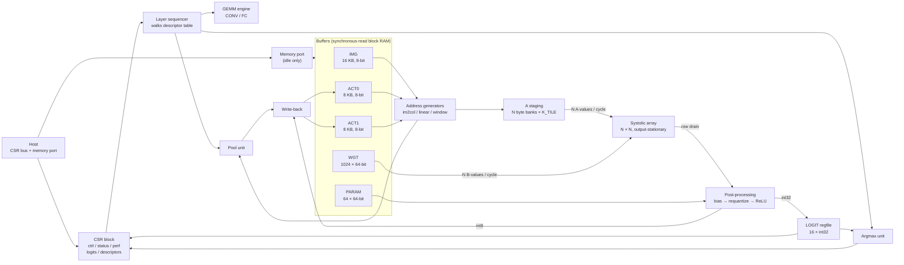

# Accelerator specification

Authoritative hardware specification for the int8 MNIST CNN accelerator (Milestone 1).
Changes to this document, or to any interface it defines, require review and approval and are
recorded in `docs/decisions.md`.

**Normative scope.** Binding requirements are:
- the arithmetic (§3);
- the data layouts and memory formats (§4–§7);
- the descriptor format and execution semantics (§8–§9);
- the host interface (§10);
- the `accel_top` and `systolic_array` interfaces (§11).

Internal module partitioning and internal interfaces are implementation choices. They are
documented in each module's header and summarized in `docs/architecture.md`.

**Reference model.** `model/golden.py` (arithmetic) and `model/hwmap.py` (memory and descriptor
formats) implement this specification in software. The RTL must match them bit for bit.

---

## 1. Network and build-time parameters

| Layer | Op | Input (H×W×C) | Output | GEMM M × K × Ncols |
|---|---|---|---|---|
| conv1 | 3×3 conv, stride 1, no padding, bias, requantize, ReLU | 28×28×1 | 26×26×8 | 676 × 9 × 8 |
| pool1 | 2×2 max, stride 2 | 26×26×8 | 13×13×8 | — |
| conv2 | 3×3 conv, stride 1, no padding, bias, requantize, ReLU | 13×13×8 | 11×11×16 | 121 × 72 × 16 |
| pool2 | 2×2 max, stride 2, floor | 11×11×16 | 5×5×16 | — |
| fc | fully connected, bias, no requantization | 5×5×16 (400) | 10 × int32 | 1 × 400 × 10 |
| argmax | lowest index of the maximum logit | 10 × int32 | class 0–9 | — |

| Parameter | Default | Meaning |
|---|---|---|
| `N` | 8 | systolic array is N × N |
| `DATA_W` | 8 | activation and weight width (signed) |
| `ACC_W` | 32 | accumulator width (signed) |
| `K_TILE` | 128 | A-staging depth; GEMMs with K > `K_TILE` run in K chunks (fc: 4 chunks) |
| `IMG_DEPTH` | 16384 | image buffer, bytes |
| `IMG_SIZE` | 784 | bytes per input image |
| `ACT_DEPTH` | 8192 | each activation buffer, bytes |
| `WGT_DEPTH` | 1024 | weight buffer, `N·DATA_W`-bit words |
| `PARAM_DEPTH` | 64 | parameter buffer, 64-bit words |
| `LOGIT_DEPTH` | 16 | logit register file, int32 entries |
| `DESC_DEPTH` | 8 | descriptor table, layers |

One clock domain (`clk`), synchronous active-high reset (`rst`). Target: 50 MHz on the MAX 10.

## 2. Block diagram



## 3. Arithmetic (bit-exact)

All values are two's complement. `>>>` is an arithmetic right shift.

| Step | Definition | Width |
|---|---|---|
| Input bytes | `q = pixel >> 1` (done offline; buffers hold `q`, 0–127) | int8 |
| Accumulate | `acc[m][n] = Σ_k A[m][k] · B[k][n]` | int32 |
| Bias | `y = acc + bias[n]` | int32 |
| Product | `p = y · M[n]`, `M` unsigned in [2^15, 2^16 − 1] | 48-bit signed |
| Round | `r = (p + 2^(S[n]−1)) >>> S[n]`, `S` in [1, 47] (round half up) | ≥ 49-bit signed |
| Saturate | `q8 = clamp(r, −128, 127)` | int8 |
| ReLU | if `relu_en`: `q8 = max(q8, 0)` | int8 |
| FC output | `logit[n] = y` (no requantization) | int32 |
| Pool | `max` over a 2×2 window (signed compare) | int8 |
| Argmax | lowest index `i` with `logit[i]` = max (signed compare) | index |

- **Accumulator overflow.** The accumulator and the bias add wrap modulo 2^32 in hardware. The golden
  model proves wrap never happens: for every GEMM it asserts
  `Σ_k |A·B| + |bias| ≤ 2^31 − 1`, which bounds every partial sum in any accumulation order.
  Saturation is therefore not implemented.
- **Requantization** applies only when `requant_en = 1` (CONV). `relu_en` applies only when
  `requant_en = 1`.
- **Weights** are int8 in [−127, 127] (symmetric). Activations after ReLU are in [0, 127]. The
  arithmetic is still defined for any int8 inputs (including −128), and unit tests use the full range.

### 3.1 Post-processing implementation

- **Signed multiply.** `M` is unsigned, but the accumulator path is signed, so the multiplier
  operand is zero-extended to 17 bits and treated as signed: `p = $signed(y) * $signed({1'b0, M})`.
  Multiplying a signed `y` by an unsigned `M` directly would make Verilog treat the whole
  expression as unsigned and corrupt negative products. The 32 × 17 signed product is 49 bits wide
  and its value always fits in 48 bits (`|y| < 2^31`, `M < 2^16`).
- **Pipelining.** To meet 50 MHz, post-processing is pipelined in at least three register stages:
  1. bias add and multiply (`y`, then `p`);
  2. rounding add and arithmetic shift (`r`);
  3. saturate and ReLU (`q8`).

  The pipeline uses valid/ready handshakes; its latency is not part of any interface.

Scales and how `M`, `S` and biases are derived are in `model/quantize.py`; the hardware only sees
the integers.

## 4. Data layouts

- **Activations are HWC (channel-last).** Element `(y, x, c)` of an `H × W × C` tensor is at byte
  offset `(y · W + x) · C + c` from the tensor's base.
- **Input images** are 28×28×1 row-major: image `i` occupies IMG bytes `[i · 784, i · 784 + 783]`.
- **im2col (CONV).** For output pixel `m = oy · W_out + ox` and reduction index
  `k = (ky · 3 + kx) · C_in + ci`:
  `A[m][k] = src[src_base + ((oy + ky) · W_in + (ox + kx)) · C_in + ci]`, and
  `B[k][co] = w[co][ky][kx][ci]`. `K = 9 · C_in`, `M = H_out · W_out`, `Ncols = C_out`.
  The output element `(m, co)` is written to `dst[m · C_out + co]`, which is HWC.
- **FC.** `A[0][k] = src[k]` for `k < K = H_in · W_in · C_in` (the HWC tensor read linearly),
  `M = 1`, `B[k][n] = w_fc[n][k]` with `k` in HWC order. Output `n` goes to `LOGIT[dst_base + n]`.

## 5. Buffers and buffer bandwidth

| Buffer | Width | Depth | Contents | Engine access |
|---|---|---|---|---|
| IMG | 8 | `IMG_DEPTH` | up to 16 input images (`q` bytes) | read (CONV/POOL/FC source) |
| ACT0, ACT1 | 8 | `ACT_DEPTH` | ping-pong activations | read or write |
| WGT | `N·DATA_W` | `WGT_DEPTH` | packed GEMM B matrices (§6) | read |
| PARAM | 64 | `PARAM_DEPTH` | per-output-channel bias, M, S (§7) | read |
| LOGIT | 32 | `LOGIT_DEPTH` | FC outputs (registers) | write (FC), read (ARGMAX, CSR) |

- Every buffer is an inferred synchronous-read RAM with **one read port and one write port**.
  **Read latency is exactly 1 cycle**; this latency is part of the buffer interface.
- A layer never reads and writes the same buffer (§9), so each buffer needs only one port of
  each kind.
- Buffers can be preloaded from `$readmemh` files (FPGA) and are always reachable through the
  memory port (§10.3) while the accelerator is idle.

**Bandwidth scheme.** The array consumes N A-values and N B-values per cycle.
- **B (weights)** are pre-packed offline so that one `N·DATA_W`-bit WGT word holds the N
  B-values of one reduction step (§6): **one WGT read per cycle feeds the array**.
- **A (activations)** come from an im2col gather that is not contiguous in memory, so A is
  **staged** before it is streamed:
  1. **Stage.** The A loader walks the tile's `N` rows and the current K chunk (`≤ K_TILE`)
     through the address generator. It reads **one byte per cycle** and writes it into staging
     bank `i` (tile row `i`) at address `k − k0`. Rows `m ≥ M` and steps `k ≥ K` are written as 0
     (zero padding of edge tiles).
  2. **Stream.** For each `k` in the chunk, all N staging banks are read in parallel (N A-values)
     together with one WGT word (N B-values) and presented to the array as one step.

  **Optional reuse.** When `K ≤ K_TILE` (a single chunk), the engine may keep the staged A tile and
  reuse it for every column tile `nt` of the same row tile instead of restaging it. Buffer
  contents after the layer are identical either way.

  Staging costs `N · Kc` cycles per chunk against `Kc` cycles of streaming. That limits MAC
  utilization, which is acceptable for Milestone 1 (correctness first, no cycle target).
  Double-buffered staging or N-banked activation buffers are possible later optimizations.

The current network uses 953 WGT words and 34 PARAM words
(`model/artifacts/mem/layout.json`, generated by `model/export.py`).

## 6. Weight buffer format

For a GEMM with reduction length `K` and `Ncols` output columns, column tile `nt`
(`0 ≤ nt < ⌈Ncols / N⌉`) and reduction step `k` map to word `wgt_base + nt · K + k`:

```
bits [8j+7 : 8j] = B[k][nt·N + j]   for j = 0 .. N−1   (0 when nt·N + j ≥ Ncols)
```

Reference implementation: `model/hwmap.py::pack_b`.

## 7. Parameter buffer format

One 64-bit word per output channel, at `param_base + n`:

| Bits | Field |
|---|---|
| [31:0] | `bias` (int32) |
| [47:32] | `M` (unsigned 16-bit; 0 for FC) |
| [53:48] | `S` (unsigned 6-bit; 0 for FC) |
| [63:54] | reserved, 0 |

Reference implementation: `model/hwmap.py::pack_params`.

## 8. Layer descriptor format

The descriptor table holds `DESC_DEPTH` descriptors of four 32-bit words; descriptor `L` occupies
words `4L .. 4L+3`. The table is written through the CSR window (§10.2) or preloaded from a
`$readmemh` file. Reference implementation: `model/hwmap.py::Descriptor`.

| Word | Bits | Field | Meaning |
|---|---|---|---|
| 0 | [2:0] | `op` | 0 CONV, 1 POOL, 2 FC, 3 ARGMAX, 4–7 reserved |
| 0 | [3] | `relu_en` | ReLU after requantization (CONV) |
| 0 | [4] | `requant_en` | requantize to int8 (CONV); 0 for FC |
| 0 | [5] | `last` | last layer: the run ends after this descriptor |
| 0 | [9:8] | `src` | source buffer: 0 IMG, 1 ACT0, 2 ACT1, 3 LOGIT |
| 0 | [13:12] | `dst` | destination buffer (same encoding; ignored by ARGMAX) |
| 1 | [15:0] | `src_base` | source base address (bytes; LOGIT entries for ARGMAX) |
| 1 | [31:16] | `dst_base` | destination base address (bytes; LOGIT entries for FC) |
| 2 | [7:0] | `h_in` | input height |
| 2 | [15:8] | `w_in` | input width |
| 2 | [23:16] | `c_in` | input channels (ARGMAX: number of logits) |
| 2 | [31:24] | `c_out` | output channels (POOL: equal to `c_in`) |
| 3 | [15:0] | `wgt_base` | WGT word address of the layer's packed B (CONV/FC) |
| 3 | [23:16] | `param_base` | PARAM word address of the layer's channel 0 (CONV/FC) |

All other bits are reserved and must be 0. The network's table is
`model/artifacts/mem/desc.hex`:

| L | op | src → dst | h_in × w_in × c_in → c_out | flags |
|---|---|---|---|---|
| 0 | CONV | IMG → ACT0 | 28×28×1 → 8 | relu, requant |
| 1 | POOL | ACT0 → ACT1 | 26×26×8 → 8 | |
| 2 | CONV | ACT1 → ACT0 | 13×13×8 → 16 | relu, requant |
| 3 | POOL | ACT0 → ACT1 | 11×11×16 → 16 | |
| 4 | FC | ACT1 → LOGIT | 5×5×16 → 10 | |
| 5 | ARGMAX | LOGIT | 10 logits | last |

## 9. Execution semantics

**Run.** Writing `CTRL.START = 1` while idle:
1. clears `DONE`, `ERROR` and the performance counters;
2. latches `IMG_SEL`;
3. sets `BUSY`;
4. executes descriptors 0, 1, 2, … in order until one with `last = 1` completes.

At the end of the run, `BUSY` is cleared and `DONE` is set. `START` while busy is ignored.

**Image selection.** When `src = IMG`, the effective source base is
`src_base + IMG_SEL · IMG_SIZE`. The descriptor table is static; only `IMG_SEL` changes between
images.

**CONV / FC.**
1. The engine computes `C = A · B` in `N × N` output tiles (§4 gives A, B, M, K, Ncols).
2. For each row tile `mt` and column tile `nt`, the K chunks are streamed in order, with the
   accumulators cleared before the first chunk.
3. The tile is then drained. Every element with `m < M` and `n < Ncols` is post-processed (§3)
   with the parameters at `param_base + n`, and written:
   - CONV: to `dst[dst_base + m · C_out + n]`;
   - FC: to `LOGIT[dst_base + n]`.

Elements of padded rows or columns are discarded. The order of writes inside a layer is not
specified; only the final buffer contents are.

**POOL.** For `oy < ⌊h_in/2⌋`, `ox < ⌊w_in/2⌋`, `c < c_in`:
`dst[dst_base + (oy · ⌊w_in/2⌋ + ox) · c_in + c] = max over dy, dx ∈ {0, 1} of
src[src_base + ((2oy + dy) · w_in + 2ox + dx) · c_in + c]`.

**ARGMAX.** `RESULT = ` the lowest index `i < c_in` maximizing `LOGIT[src_base + i]`.

**Ping-pong.** Consecutive layers alternate ACT0 and ACT1 as given by the descriptors. The input
image lives in its own buffer (IMG), so overwriting ACT0/ACT1 never destroys an image, and
images can run back to back without reloading.

**Errors.** The run stops with `ERROR = 1`, `DONE = 1`, `BUSY = 0` if:
- a descriptor has a reserved `op`;
- a CONV, POOL or FC descriptor has `dst = IMG`;
- `DESC_DEPTH` descriptors execute without one having `last = 1`.

Other inconsistent descriptors (src = dst, sizes exceeding a buffer, a non-HWC-consistent
`c_out` for POOL) are not detected and give undefined buffer contents.

## 10. Host interface (Milestone 1)

### 10.1 CSR bus

32-bit registers with byte addresses (word aligned; address bits [1:0] are ignored).

| Signal | Dir | Width | Meaning |
|---|---|---|---|
| `i_csr_valid` | in | 1 | request valid; hold `addr`, `we`, `wdata` stable until accepted |
| `i_csr_we` | in | 1 | 1 write, 0 read |
| `i_csr_addr` | in | 12 | byte address |
| `i_csr_wdata` | in | 32 | write data |
| `o_csr_ready` | out | 1 | request accepted in a cycle with `valid && ready` |
| `o_csr_rdata` | out | 32 | read data, valid in the accepting cycle |

Latency from `valid` to `ready` is not fixed (descriptor reads take an extra cycle). Unmapped
addresses read as 0 and ignore writes.

### 10.2 CSR map

| Offset | Name | Access | Reset | Bits |
|---|---|---|---|---|
| 0x000 | `ID` | RO | constant | `0x434E4E31` ("CNN1") |
| 0x004 | `CONFIG` | RO | constant | [7:0] `N`, [15:8] `DATA_W`, [23:16] `ACC_W`, [31:24] `DESC_DEPTH` |
| 0x010 | `CTRL` | WO | 0 | [0] `START` (write 1; ignored while busy); reads 0 |
| 0x014 | `STATUS` | RO | 0 | [0] `BUSY`, [1] `DONE`, [2] `ERROR`, [11:8] index of the current (or last) layer |
| 0x018 | `IMG_SEL` | RW | 0 | [3:0] image index; latched at START; writes while busy are ignored |
| 0x01C | `RESULT` | RO | 0 | [7:0] predicted class (valid when `DONE` and not `ERROR`) |
| 0x020 | `CYC_TOTAL` | RO | 0 | cycles from START to DONE |
| 0x024 | `CYC_MAC` | RO | 0 | cycles in which the array consumed a reduction step |
| 0x028 | `BUF_RD` | RO | 0 | buffer reads issued by the engine, pool and argmax units |
| 0x02C | `BUF_WR` | RO | 0 | buffer writes issued by the engine and pool unit |
| 0x040 + 4L | `LAYER_CYC[L]` | RO | 0 | cycles spent in layer `L`, `L < DESC_DEPTH` |
| 0x080 + 4i | `LOGIT[i]` | RO | 0 | int32 logit `i`, `i < LOGIT_DEPTH` |
| 0x100 + 4w | `DESC[w]` | RW | not reset | descriptor word `w`, `w < 4 · DESC_DEPTH`; writes while busy are ignored |

**Reset.** `rst` returns every CSR to the value in the Reset column (0 unless stated) and aborts
any run in progress (`BUSY = 0`, `DONE = 0`). It does **not** clear the descriptor table or any
buffer (IMG, ACT0, ACT1, WGT, PARAM): they keep their preloaded or last-written contents, so a
reset never requires reloading weights, images or descriptors.

Performance counters are cleared at START, count while `BUSY`, and hold their values afterwards.
They saturate at 2^32 − 1.

### 10.3 Memory port

Loads and reads back the buffers while the accelerator is idle (images, weights, parameters, and
activations for debugging).

| Signal | Dir | Width | Meaning |
|---|---|---|---|
| `i_mem_valid` | in | 1 | request valid |
| `o_mem_ready` | out | 1 | request accepted when `valid && ready`; 0 while `BUSY` or a read is pending |
| `i_mem_we` | in | 1 | 1 write, 0 read |
| `i_mem_sel` | in | 3 | 0 IMG, 1 ACT0, 2 ACT1, 3 WGT, 4 PARAM; 5–7 reserved (writes ignored, reads 0) |
| `i_mem_addr` | in | 16 | word address in the selected buffer (bits above its width are ignored) |
| `i_mem_wdata` | in | 64 | write data (byte buffers use [7:0]) |
| `o_mem_rvalid` | out | 1 | one-cycle pulse with read data, exactly once per accepted read |
| `o_mem_rdata` | out | 64 | read data (byte buffers zero-extended), valid with `o_mem_rvalid` |

At most one read is outstanding. Read-data latency is not fixed; masters wait for `o_mem_rvalid`.

## 11. Module interfaces

### 11.1 `accel_top`

Parameters: those in §1, plus init-file strings `IMG_INIT`, `WGT_INIT`, `PARAM_INIT`, `DESC_INIT`
(empty = no preload).

Ports: `clk`, `rst`, the CSR bus (§10.1), the memory port (§10.3), and these status outputs for
the FPGA top:

| Signal | Width | Meaning |
|---|---|---|
| `o_busy` | 1 | `STATUS.BUSY` |
| `o_done` | 1 | `STATUS.DONE` |
| `o_error` | 1 | `STATUS.ERROR` |
| `o_result` | 8 | `RESULT` |
| `o_cyc_total` | 32 | `CYC_TOTAL` |

### 11.2 `systolic_array`

This is the interface that the output-stationary array (M1) and the weight-stationary array (M3)
must both implement. It is defined at the level of one output tile: stream K reduction steps,
then drain the `N × N` result. Input skewing is internal.

| Signal | Dir | Width | Meaning |
|---|---|---|---|
| `i_clear` | in | 1 | zero all accumulators; only while no step is in flight |
| `i_valid` | in | 1 | one reduction step this cycle (no backpressure: always accepted); may deassert between steps |
| `i_a` | in | `N·DATA_W` | byte `i` = `A[row i][k]` |
| `i_b` | in | `N·DATA_W` | byte `j` = `B[k][col j]` |
| `i_drain` | in | 1 | pulse after the last step: begin emitting the result |
| `o_row_valid` | out | 1 | a result row is available |
| `i_row_ready` | in | 1 | consumer accepts the row (`valid && ready`) |
| `o_row_data` | out | `N·ACC_W` | word `j` = `C[row][col j]` (int32) |
| `o_row_last` | out | 1 | marks row `N − 1` |
| `o_idle` | out | 1 | no step in flight and no drain pending |

**Step timing.** `i_valid` may deassert for any number of cycles between steps, including
between K chunks. The accumulators hold their values while no step is presented, and the result
depends only on the sequence of steps, never on their timing. A weight-stationary implementation
of this interface is outlined in D-015.

**Drain window.** From the cycle `i_drain` is asserted until the cycle the last row (`o_row_last`)
is accepted, the producer must not assert `i_valid` or `i_clear`.

Rows are emitted in order 0 … N−1. The latency from `i_drain` to the first row is
implementation-specific. Consumers use the handshake, never a cycle count. After the last row
is accepted the array returns to idle with its accumulators unspecified until the next `i_clear`.

## 12. FPGA integration (summary)

The DE10-Lite top instantiates `accel_top` with images, weights, parameters and descriptors
preloaded from init files generated by `model/export.py`. It drives the CSR bus from a small
controller:
- `SW[3:0]` → `IMG_SEL`;
- a debounced `KEY[0]` press → `START`.

`o_result` drives `HEX0`, and the true label drives `HEX1`. Reset, synchronizers and the display
are specified in Phase 4.
